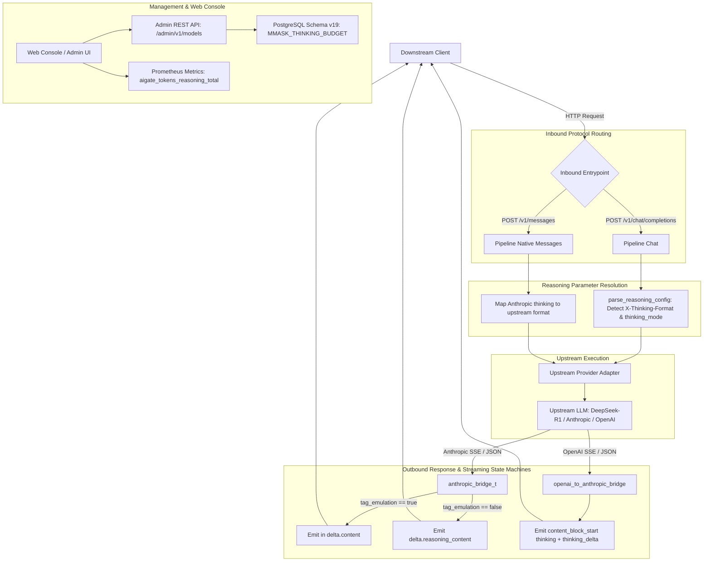

# Reasoning Ecosystem V2 Design Specification: Tag Emulation, Native Claude Messages Bridge & Web Console Enhancements

**Date**: 2026-10-11  
**Status**: Approved  
**Author**: Antigravity & Pair Programming Team  
**Scope**: `aigate` Core Gateway, Upstream Protocol Adapters, Admin REST API, Web Console UI  

---

## 1. Executive Summary & Motivation

In the previous iteration (V1), `aigate` established cross-protocol reasoning interoperability:
- Hierarchical reasoning budget resolution (explicit tokens, `reasoning_effort`, and model catalog defaults).
- Inbound translation with Anthropic `max_tokens` auto-lift safety guards (`max_tokens = budget_tokens + 4096`).
- Outbound translation from Anthropic `thinking` blocks to OpenAI `choices[0].message.reasoning_content` and streaming `delta.reasoning_content`.
- Steganographic watermark non-interference and Prometheus metrics exposition (`aigate_tokens_reasoning_total`).

While functional for modern OpenAI clients, production operations reveal three critical usability and ecosystem gaps:
1. **Legacy Client Incompatibility**: Many widely used AI applications (Chatbox, NextChat, legacy LangChain/LlamaIndex, older SDKs) do not parse OpenAI's optional `reasoning_content` field and display empty bubbles until the final answer. They require standard `<think>...</think>` tags embedded directly in `content`.
2. **Native Claude API Asymmetry**: When clients query `aigate` via Anthropic's native `/v1/messages` endpoint (used by Claude Code, Cursor, and Anthropic SDKs), routing to reasoning models like DeepSeek-R1 or QwQ currently drops or misplaces `reasoning_content` because the inverse translation pipeline is missing.
3. **Admin UI & Observability Blind Spots**: The Web Console lacks UI fields to configure `default_thinking_budget` and `supports_reasoning`, the metrics dashboard does not visualize reasoning token ratios, and the Playground playground dumps the raw thinking stream directly into the answer window without a collapsible accordion.

This specification defines the V2 architecture to close these gaps with zero overhead, high throughput, and seamless backward/forward compatibility.

---

## 2. Architecture Overview & System Flow



---

## 3. Detailed Technical Specifications

### 3.1 `<think>` Tag Emulation State Machine

#### 3.1.1 Request-Level Detection
In [`src/upstream/provider_adapter.c`](file:///home/quintin/Data/source/c_cpp/aigate/src/upstream/provider_adapter.c) (`parse_reasoning_config`):
- **HTTP Header Detection**: Scan request headers for `X-Thinking-Format: tag` (case-insensitive).
- **JSON Body Detection**: Scan request payload for `"thinking_mode": "tag"` or `"thinking_format": "tag"`.
- **Configuration Field**:
  ```c
  typedef struct reasoning_config {
      bool enabled;           /**< True if reasoning is active */
      long budget_tokens;     /**< Token budget cap (0 = unlimited / model default) */
      char effort[16];        /**< low | medium | high */
      bool tag_emulation;     /**< True to output <think>...</think> in content */
  } reasoning_config_t;
  ```

#### 3.1.2 Streaming SSE State Machine (`anthropic_bridge_t`)
State transitions during SSE stream decoding in [`src/upstream/provider_anthropic.c`](file:///home/quintin/Data/source/c_cpp/aigate/src/upstream/provider_anthropic.c):
1. **Initial Thinking Chunk (`content_block_start: thinking` or `thinking_delta`)**:
   - If `b->tag_emulation && !b->tag_opened`:
     - Emits chunk:
       ```json
       data: {"id":"chatcmpl-...","object":"chat.completion.chunk","choices":[{"index":0,"delta":{"content":"<think>\n"},"finish_reason":null}]}
       ```
     - Sets `b->tag_opened = true`.
2. **Active Thinking Deltas**:
   - If `b->tag_emulation`:
     - Emits chunk with thinking text inside `delta.content`:
       ```json
       data: {"id":"chatcmpl-...","object":"chat.completion.chunk","choices":[{"index":0,"delta":{"content":"thinking text..."}}]}
       ```
   - If `!b->tag_emulation`:
     - Emits standard `delta.reasoning_content`.
3. **Transition to Answer Content (`text_delta` or `content_block_stop`)**:
   - If `b->tag_emulation && b->tag_opened && !b->tag_closed`:
     - Emits closing chunk:
       ```json
       data: {"id":"chatcmpl-...","object":"chat.completion.chunk","choices":[{"index":0,"delta":{"content":"\n</think>\n\n"},"finish_reason":null}]}
       ```
     - Sets `b->tag_closed = true`.
   - Subsequent `text_delta` chunks emit regular `delta.content` as normal.
4. **Stream Abort / Early Termination Guard**:
   - In `stream_bridge_finish`, if `b->tag_opened && !b->tag_closed`, emit `\n</think>\n\n` prior to `[DONE]`.

#### 3.1.3 Non-Streaming Response Formatting
In `provider_anthropic_resp_to_openai`:
- If `rcfg.tag_emulation` is active and `thinking_text` is non-empty:
  - Formulate message content:
    ```c
    snprintf(full_content, cap, "<think>\n%s\n</think>\n\n%s", thinking_text, content_text ? content_text : "");
    json_object_set_new(msg, "content", json_string(full_content));
    ```
- Preserves raw `reasoning_content` as an additional optional field for hybrid consumers.

---

### 3.2 Native Claude `/v1/messages` Bi-Directional Bridge

#### 3.2.1 Native Non-Streaming Translation (`openai_resp_to_anthropic`)
When a client queries `POST /v1/messages` in [`src/core/pipeline_native.c`](file:///home/quintin/Data/source/c_cpp/aigate/src/core/pipeline_native.c) and routes to an OpenAI-compatible reasoning model (DeepSeek-R1 / QwQ):
- Parses `choices[0].message.reasoning_content` and `choices[0].message.content`.
- Constructs an Anthropic-compliant JSON message payload:
  ```json
  {
    "id": "msg_01...",
    "type": "message",
    "role": "assistant",
    "model": "deepseek-r1",
    "content": [
      {
        "type": "thinking",
        "thinking": "Step 1: Analyzing prompt..."
      },
      {
        "type": "text",
        "text": "The proof is as follows..."
      }
    ],
    "stop_reason": "end_turn",
    "stop_sequence": null,
    "usage": {
      "input_tokens": 150,
      "output_tokens": 300
    }
  }
  ```

#### 3.2.2 Native Streaming SSE Bridge (`openai_to_anthropic_stream_bridge`)
Maintains index tracking for Anthropic content blocks:
- **Index 0 (Thinking Block)**:
  - First `delta.reasoning_content`:
    `event: content_block_start` with `{"type":"content_block_start","index":0,"content_block":{"type":"thinking","thinking":""}}`
  - Subsequent `delta.reasoning_content`:
    `event: content_block_delta` with `{"type":"content_block_delta","index":0,"delta":{"type":"thinking_delta","thinking":"..."}}`
- **Block Switch**:
  - Upon receiving first `delta.content`:
    `event: content_block_stop` with `{"type":"content_block_stop","index":0}`
- **Index 1 (Text Content Block)**:
  - First `delta.content`:
    `event: content_block_start` with `{"type":"content_block_start","index":1,"content_block":{"type":"text","text":""}}`
  - Subsequent `delta.content`:
    `event: content_block_delta` with `{"type":"content_block_delta","index":1,"delta":{"type":"text_delta","text":"..."}}`
- **Stream Finalization**:
  - `event: content_block_stop` (`index: 1`)
  - `event: message_delta` (`stop_reason: "end_turn"`, usage metrics)
  - `event: message_stop`

---

### 3.3 Control Plane REST API Extensions (`src/server/admin_api.c`)

1. **`model_create` (POST `/admin/v1/models`)**:
   - Parses `supports_reasoning` (`bool`, defaults to `false`).
   - Parses `default_thinking_budget` (`integer`, defaults to `0`).
2. **`model_list` (GET `/admin/v1/models`)**:
   - Serializes `"supports_reasoning": true/false`.
   - Serializes `"default_thinking_budget": <tokens>`.
3. **`model_patch` (PATCH `/admin/v1/models/<name>`)**:
   - Checks presence of `"supports_reasoning"` and `"default_thinking_budget"`.
   - Sets `MMASK_SUPPORTS_REASONING` and `MMASK_THINKING_BUDGET` flags.
   - Updates PostgreSQL `models` table via `ops->update_model`.

---

### 3.4 Web Console (Admin UI) Enhancements (`src/server/admin_ui.html`)

1. **Model Management Modal**:
   - Form controls:
     - Checkbox: `支持深度思考 (supports_reasoning)`
     - Number Input: `默认思考预算 Token (default_thinking_budget)` with quick presets: `0 (无限制)`, `2048`, `4096`, `8192`.
   - Model Table:
     - Displays purple pill badge `Reasoning` next to models with `supports_reasoning == true` or `default_thinking_budget > 0`.
2. **Metrics & Overview Dashboard**:
   - Stat Card: `思考 Token (Reasoning Tokens)` displaying value from `aigate_tokens_reasoning_total`.
   - Distribution Gauge: Visual breakdown of `Prompt` vs `Completion` vs `Reasoning` tokens.
3. **Playground Debugging Console**:
   - Option toggles: `启用思考预算` and `<think> 标签仿真兼容模式`.
   - Dynamic Collapsible Card Component (`💭 思考过程 (展开/折叠)`):
     - Renders an accordion container above the answer text.
     - Live stream typing effect for thinking text with distinct monospace muted styling.
     - Automatically collapses or allows single-click toggle when answer generation begins.

---

## 4. Error Handling & Edge Cases

1. **Premature Stream Disconnect during Thinking**:
   - If client disconnects while inside a `<think>` block, the connection is closed cleanly, ring buffer records `interrupted`, and usage meter tracks accumulated reasoning tokens without emitting dangling chunks.
2. **Model Lacks Reasoning Capability**:
   - If client requests `thinking_mode: "tag"` on a standard model (e.g. `gpt-4o`), tag emulation is bypassed gracefully with zero overhead.
3. **Budget Exceeds Context Length**:
   - Clamped by existing Anthropic `max_tokens` auto-lift safety guard: `max_tokens = budget_tokens + 4096`.

---

## 5. Test & Verification Plan

### 5.1 Unit Tests (`tests/unit/`)
- `test_thinking_tag_emulation_stream`: Verify `<think>\n` emitted on start, deltas inside content, and `\n</think>\n\n` on switch.
- `test_thinking_tag_emulation_sync`: Verify non-streaming `<think>...</think>` wrapper in content.
- `test_openai_to_anthropic_thinking_sync`: Verify OpenAI response converted to Anthropic `thinking` block.
- `test_openai_to_anthropic_thinking_stream`: Verify Anthropic SSE events (`content_block_start`, `thinking_delta`, `content_block_stop`).
- `test_admin_api_model_reasoning_crud`: Verify `POST/GET/PATCH` model APIs persist `supports_reasoning` and `default_thinking_budget`.

### 5.2 Python E2E Integration Tests (`tests/integration/`)
- Extend `tests/integration/test_reasoning_models.py`:
  - Request with `X-Thinking-Format: tag` verifies `<think>` tag in response body.
  - Native Anthropic request to mock DeepSeek model verifies Anthropic `type: "thinking"` blocks.
  - Admin API creation and update of reasoning parameters.

### 5.3 Quality Gates
- Compiles with `-Wall -Wextra -Werror` (0 warnings).
- Full CTest suite 100% PASS (6/6 suites, 320+ unit tests).
